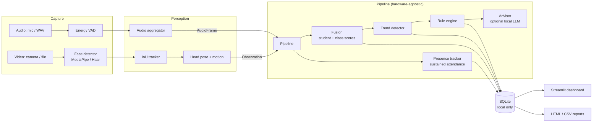

# 🎓 Multimodal Attendance & Engagement Agent

An offline, privacy-preserving classroom intelligence system. It fuses **computer vision**, **audio signal processing** and **rule-based agent reasoning** to mark attendance automatically, measure engagement over time, and give teachers advisory suggestions.

> Quick taste, no camera needed: `pip install -r requirements.txt && pip install -e . && python -m maea demo && python -m maea dashboard`

## Features

| | |
|---|---|
| **Automated attendance** | Face tracking + *sustained-presence* logic (no single-frame false positives), timestamped arrival / leave / return log |
| **Engagement analysis** | Head pose, movement, inactivity and audio activity fused into per-student and class scores |
| **Session dynamics** | Smoothed trend line, automatic detection of attention drops and interaction peaks |
| **AI teaching suggestions** | Rule engine detects patterns; optional local LLM (Ollama) polishes the wording. Advisory only |
| **Dashboard** | Overview, attendance table + presence timeline, engagement heatmap, suggestions, exports |
| **Privacy by design** | Fully offline, no video/audio stored, anonymous IDs, consent gate, retention purge |

## Architecture



**Design principle:** the `Pipeline` consumes plain `Observation` and `AudioFrame` objects and never touches a camera. Live capture, recorded video and the synthetic demo all drive the *same* logic, which is also why the core is easy to unit test.

### Project layout

```
src/maea/
├── config.py            typed settings (configs/default.toml)
├── core/models.py       shared data classes
├── capture/             video_source.py, audio_source.py
├── vision/              detector.py, tracker.py, head_pose.py, motion.py
├── audio/               vad.py, aggregator.py
├── attendance/          presence.py        sustained-presence logic
├── fusion/              engagement.py, trends.py
├── agent/               rules.py, advisor.py
├── storage/db.py        SQLite persistence + privacy purge
├── pipeline.py          orchestrator
├── runner.py            camera/video -> pipeline glue
├── demo.py              synthetic classroom generator
├── reports.py           HTML + CSV export
├── dashboard/app.py     Streamlit UI
└── cli.py               `python -m maea ...`
tests/                   17 unit + end-to-end tests
```

## Install

```bash
python -m venv .venv && source .venv/bin/activate      # Windows: .venv\Scripts\activate
pip install -r requirements.txt
pip install -e .
```
Camera/video analysis needs `opencv-python` and `mediapipe` (included in `requirements.txt`). The demo and dashboard need only numpy, pandas, plotly and streamlit.

## Usage

| Command | What it does |
|---|---|
| `python -m maea demo` | Simulate a 45-minute class and save it |
| `python -m maea dashboard` | Open the web dashboard |
| `python -m maea run --video 0 --mic --consent --show` | Analyse the live webcam + microphone |
| `python -m maea run --video lecture.mp4 --audio lecture.wav --consent` | Analyse a recording |
| `python -m maea sessions` | List saved sessions |
| `python -m maea report --session 1` | Export HTML report + CSV files |
| `python -m maea purge` | Delete sessions older than the retention period |

Tip: extract audio from a video with `ffmpeg -i lecture.mp4 -ac 1 -ar 16000 lecture.wav`.

## How it works

**Attendance.** A person is marked present only after being visible for `confirm_sec` (30 s) with ≥ 70 % visibility over a sliding window. The logged arrival time is the *first* sighting. Absences longer than `gap_sec` are logged as LEFT / RETURNED. Short flickers are rejected and counted.

**Per-student signals (each 60 s window).**
- *Attention*: share of frames with |yaw| < 25° and |pitch| < 20° (head pose via `solvePnP` on six landmarks; falls back to "face is frontal" with the Haar detector).
- *Movement*: mean face-centre displacement, normalised by face width.
- *Inactivity*: share of the window spent in still stretches longer than 20 s.

**Audio.** Adaptive-noise-floor VAD → speech ratio, interaction bursts per minute, and a mode: `lecture`, `discussion`, `silence` or `mixed`.

**Fusion.**
```
student_score = 0.45·attention + 0.25·movement + 0.30·(1 − inactivity)
class_score   = mean(student_score)  (+0.05 in discussion, −0.08 if silent and attention < 50 %)
smoothed      = exponential moving average (α = 0.4)
drop / peak   = smoothed ≥ 20 % below / 15 % above the previous 5-window baseline
```

**Suggestions.** Six small rules (sustained low engagement, attention drop, quiet-and-disengaged, no interaction, inactive class, positive momentum) with a per-rule cooldown. Add your own by writing a function `Context -> Suggestion | None` in `agent/rules.py`.

All weights, thresholds and windows live in `configs/default.toml`. No code changes are needed to tune them.

## Privacy

- 100 % local: no cloud calls (the optional LLM runs on `localhost`).
- Raw frames and audio are **never written to disk**; only scores and timestamps are stored.
- Students appear as `Student_NN`; no face embeddings are stored.
- Live analysis requires an explicit `--consent` flag.
- Retention purge and per-session deletion are built in.
- Individual scores are for spotting patterns, not for grading or discipline.

## Testing

```bash
pytest -q
```
Covers sustained presence, VAD and audio modes, fusion maths, trend detection, rules and cooldowns, the tracker, and a full end-to-end session through the real pipeline (including report export and data deletion).

For real-world validation, measure attendance precision/recall against a manual roll, head-pose error against labelled frames, VAD F1 on annotated audio, and correlate engagement with instructor-rated segments.

## Known limitations & roadmap

- Face Mesh works best with faces of moderate size; for large halls plug a YOLO-face detector into `vision/detector.py` (one `detect()` method).
- Tracking is IoU-based: a student who leaves the frame for longer than `max_missing_sec` gets a new ID. Optional face-embedding re-identification is the natural next step (it would require stronger consent and storage controls).
- Energy VAD cannot tell speakers apart; "interaction bursts" are a proxy for turn-taking.
- Engagement is an estimate from behavioural cues, not a measure of learning.

## License
MIT
